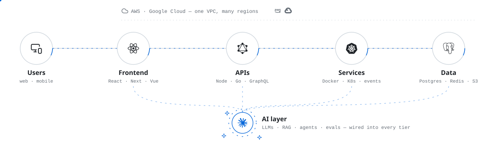
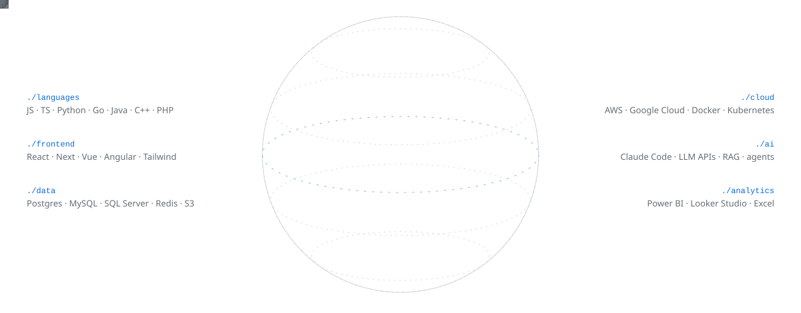
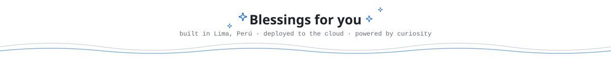

<picture>
  <source media="(prefers-color-scheme: dark)" srcset="./assets/hero-dark.svg">
  
</picture>

  

 

<picture>
  <source media="(prefers-color-scheme: dark)" srcset="./assets/h-about-dark.svg">
  
</picture>

I'm a **self-taught engineer** from Lima, Perú 🇵🇪 who likes owning the whole picture — from the pixel on the screen to the pod in the cluster.

- ☁️ &nbsp;I design **cloud-native architectures** on AWS and Google Cloud: secure, observable and built to scale.
- 🧩 &nbsp;I ship **full-stack products** end to end — UI, APIs, services, data and deployment.
- 🤖 &nbsp;I build **AI-first**: LLMs, RAG and agents as core features, not add-ons.
- ⚡ &nbsp;I work with AI-assisted workflows (Claude Code) to move fast without cutting corners.
- 🌱 &nbsp;Currently going deeper into **Kubernetes at scale**, **AI agents** and **MLOps**.
- 🏢 &nbsp;Building at **Vegas Company** · 🎮 Warzone after hours.
- 🚀 &nbsp;**Open to new opportunities** — portfolio at [morales.me](https://moraless.vercel.app).

 

<picture>
  <source media="(prefers-color-scheme: dark)" srcset="./assets/h-architecture-dark.svg">
  
</picture>

<picture>
  <source media="(prefers-color-scheme: dark)" srcset="./assets/architecture-dark.svg">
  
</picture>

 

<picture>
  <source media="(prefers-color-scheme: dark)" srcset="./assets/h-stack-dark.svg">
  
</picture>

<picture>
  <source media="(prefers-color-scheme: dark)" srcset="./assets/sphere-dark.svg">
  
</picture>

 

<picture>
  <source media="(prefers-color-scheme: dark)" srcset="./assets/h-stats-dark.svg">
  
</picture>

<picture>
  <source media="(prefers-color-scheme: dark)" srcset="https://github-readme-stats.vercel.app/api?username=jlmoralesv&show_icons=true&include_all_commits=true&count_private=true&hide_border=true&theme=transparent&title_color=58A6FF&icon_color=58A6FF&text_color=8B949E">
  
</picture>
<picture>
  <source media="(prefers-color-scheme: dark)" srcset="https://github-readme-stats.vercel.app/api/top-langs/?username=jlmoralesv&layout=compact&langs_count=8&hide_border=true&theme=transparent&title_color=58A6FF&text_color=8B949E">
  
</picture>

<picture>
  <source media="(prefers-color-scheme: dark)" srcset="https://streak-stats.demolab.com/?user=jlmoralesv&theme=transparent&hide_border=true&stroke=30363D&ring=58A6FF&fire=58A6FF&currStreakNum=E6EDF3&sideNums=E6EDF3&currStreakLabel=58A6FF&sideLabels=8B949E&dates=8B949E">
  
</picture>

<picture>
  <source media="(prefers-color-scheme: dark)" srcset="https://raw.githubusercontent.com/jlmoralesv/jlmoralesv/output/snake-dark.svg">
  
</picture>

 

<picture>
  <source media="(prefers-color-scheme: dark)" srcset="./assets/h-connect-dark.svg">
  
</picture>

  &nbsp;&nbsp;
  &nbsp;&nbsp;
  &nbsp;&nbsp;
  &nbsp;&nbsp;
  

 

<picture>
  <source media="(prefers-color-scheme: dark)" srcset="./assets/footer-dark.svg">
  
</picture>
